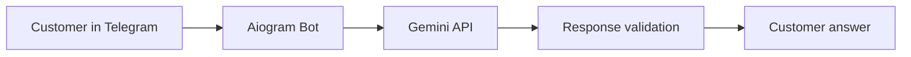

# 🎨 Paint-Info-Bot

<div align="center">
  <h3>AI customer support assistant for a paint and decoration store</h3>
  <p>
    
    
    
    
  </p>
</div>

Paint-Info-Bot is a Telegram AI assistant designed for an online paint store. It helps customers quickly find products, store locations, promotions, delivery information, and tinting services using a strict knowledge base instead of free-form internet answers.

It is built with Aiogram 3 and Google Gemini API, and is optimized for reliable customer service with answer validation and retry logic under API overload conditions.

## ✨ Why this bot matters

- Instant product guidance for customers
- Answers based on company knowledge only
- Safe, clean responses without Markdown clutter
- Stable handling of Gemini API failures
- Ideal for retail support automation

## 🧠 Demo preview

```text
Customer: Hi! Do you have interior paint for bedrooms?
Bot: Yes, we have matte and satin interior paints in several color families.
    The most popular options are: ...

Customer: What are your working hours?
Bot: Our store is open Monday–Saturday from 9:00 to 18:00.

Customer: Do you provide color matching?
Bot: Yes. We offer tinting services for both interior and exterior paints.
```

## 🏗️ Architecture



## 🚀 Features

<div align="left">

| Feature | Description |
|---|---|
| Knowledge-based answers | Answers are generated from a controlled company knowledge base |
| Retail support automation | Handles catalog, contact, hours, promotions, and services questions |
| Clean output | Removes Markdown formatting to keep replies readable in Telegram |
| Retry safety | Automatically retries requests on temporary API overload |
| Telegram-native UX | Works directly in chat with fast typing feedback |

</div>

## 🛠️ Tech stack

- Python 3.11+
- Aiogram 3
- Google Gemini API
- Telegram Bot API
- Asyncio-based request management

## 📦 Installation

1. Clone the repository:

```bash
git clone https://github.com/timatym1/Paint-Info-Bot.git
cd Paint-Info-Bot
```

2. Create and activate a virtual environment:

```bash
python -m venv .venv
source .venv/bin/activate
```

On Windows:

```bash
python -m venv .venv
.venv\Scripts\activate
```

3. Install dependencies:

```bash
pip install -r requirements.txt
```

4. Configure credentials:

Create a `.env` file or update the bot configuration values with your keys:

```env
TELEGRAM_BOT_TOKEN=your_telegram_bot_token
GEMINI_API_KEY=your_google_gemini_api_key
```

## ▶️ Run the bot

```bash
python main.py
```

The bot will start polling Telegram for incoming messages and respond to customer inquiries.

## 🔐 How it works

1. A customer sends a question in Telegram.
2. The bot marks the action as "typing" to improve UX.
3. The request is sent to Gemini with a company-specific system prompt.
4. The response is cleaned and validated.
5. If the AI API is overloaded, the bot retries automatically.

## 📌 Example use cases

- "Do you have white paint for walls?"
- "What is your address?"
- "What discounts are active this week?"
- "Can you mix paint colors?"
- "How much does delivery cost?"

## 💡 Project goals

This project demonstrates how to build a practical AI support bot for a local business using:

- Lightweight chat automation
- Controlled knowledge boundaries
- Real-world support workflows
- Safe customer communication patterns


## 🧾 License

This project is distributed for educational and business prototype use. Please check the repository license before commercial deployment.

## 🤝 Contributing

Contributions are welcome. If you want to improve the product knowledge, add new commands, or improve reliability, feel free to open a pull request.

## 📬 Contact

For collaboration or product support, contact the repository owner via GitHub.
